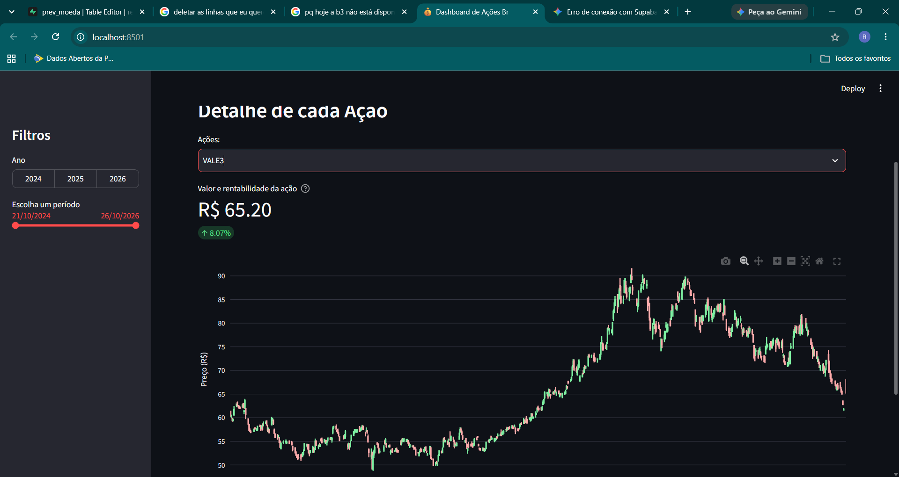
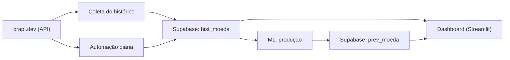

# 📈 Dashboard de Ações Brasileiras com Previsão do Próximo Pregão

Dashboard interativo que acompanha as ações da **Petrobras (PETR4)**, **Vale (VALE3)**, **Magazine Luiza (MGLU3)** e **Itaú (ITUB4)** desde outubro de 2024, com dados da [Brapi.dev](https://brapi.dev). O projeto também inclui um modelo de Machine Learning que prevê abertura, máxima, mínima e fechamento do pregão seguinte.

> ⚠️ Projeto educacional. As previsões não são recomendação de investimento.

**Stack:** Python · Pandas · scikit-learn (Regressão Linear e Regressão Logística) · Streamlit · Plotly · SQLAlchemy · Supabase (PostgreSQL) · Brapi.dev



## Funcionalidades

- **Filtros** por ano e por período (slider de datas).
- **Aba Detalhe:** gráfico de candlestick de cada ação, com a métrica do fechamento do dia atual e a variação no período selecionado.
- **Aba Detalhes:** evolução do fechamento das quatro ações lado a lado, com a variação no dia anterior.
- **Aba Previsão:** candle previsto (abertura, máxima, mínima e fechamento) para o próximo pregão de cada ação.

## Arquitetura



### Estrutura do projeto

```
.
├── coleta/        # coleta do histórico diário das 4 ações na Brapi.dev
├── automacao/     # atualização diária do banco de dados
├── dash/          # dashboard em Streamlit
└── ml/
    ├── estudo/    # notebooks: comparação e avaliação dos modelos
    └── producao/  # modelo em produção: previsão do próximo pregão
```

| Pasta | O que faz |
|---|---|
| **Coleta** | Busca o histórico diário (intervalo de 1 dia) das quatro ações na Brapi.dev e grava no Supabase. |
| **Automação** | Todo dia consulta a API, verifica se há dados do pregão atual ainda não gravados e os insere no banco, mantendo o dashboard atualizado. |
| **Dash** | Dashboard que lê o histórico (`hist_moeda`) e as previsões (`prev_moeda`). |
| **ML / jupyter** | Experimentos para escolher o melhor modelo e avaliar o desempenho. |
| **ML / Produção** | Usa o modelo escolhido para prever, com os dados do dia, o pregão seguinte e grava em `prev_moeda`. |

## Modelo de Machine Learning

- **O que prevê:** abertura, máxima, mínima e fechamento do próximo pregão, por meio de **Regressão Linear**.
- **Features:** retornos diários e defasagens (lags de 1 a 5 dias), médias móveis de 5 e 20 dias, volatilidade, amplitude do dia e variáveis de calendário.
- **Pré-processamento:** `StandardScaler` nas features e `LabelEncoder` no símbolo da ação.
- **Produção:** o modelo treinado é salvo com `joblib` e carregado na rotina diária de previsão.

## Aprendizados

### 1. Métricas excelentes não garantiram uma boa previsão

Na avaliação inicial, o modelo apresentou **R² de 0,9992 e RMSE de 0,67**. Porém, ao comparar as previsões geradas em produção com os preços reais do pregão seguinte, percebi que os valores previstos ficavam próximos dos preços recentes, mas o modelo **não identificava de forma consistente se a ação subiria ou cairia**.

Ao prever o preço absoluto (e não a variação), basta repetir o preço de hoje para ter um erro baixo, e isso infla as métricas. A lição foi que métricas altas, isoladamente, não garantem que o modelo generalize para dados novos. É preciso comparar com um baseline simples ("amanhã = hoje") e avaliar em condições próximas às do uso real.

### 2. Classificar acertos e erros com Regressão Logística

Experimentei usar a **Regressão Logística** para classificar cada previsão como acerto ou erro, com margem de tolerância de 0,5, e consegui treinar o modelo no notebook. O desafio apareceu ao levá-lo para produção: no momento de prever o próximo pregão, **ainda não existe o preço real** necessário para saber se a previsão acertou, então o rótulo só fica disponível depois do fechamento.

## Próximos passos

- Prever o **retorno** do próximo pregão (e/ou a direção: subiu ou caiu) em vez do preço absoluto.
- Validar com **divisão temporal** dos dados e comparar sempre com o baseline "amanhã = hoje".
- Guardar o histórico de previsões e compará-lo com o fechamento real, medindo o desempenho do modelo em produção ao longo do tempo.
- Usar esse histórico para estimar a confiança de cada previsão (aproveitando o experimento com Regressão Logística).

## Como executar

1. Instale as dependências:
   ```bash
   pip install -r requirements.txt
   ```
2. Crie um arquivo `.env` na raiz com as credenciais do banco:
   ```env
   DB_USER=...
   PASSWORD=...
   DB_HOST=...
   ```
3. Rode o dashboard:
   ```bash
   streamlit run dash/dashboard_acoes.py
   ```

## Autor

**Raimundo Elias** · [LinkedIn](www.linkedin.com/in/raimundo-elias-dos-santos-neto) · [GitHub](https://github.com/Raimundo2004)

